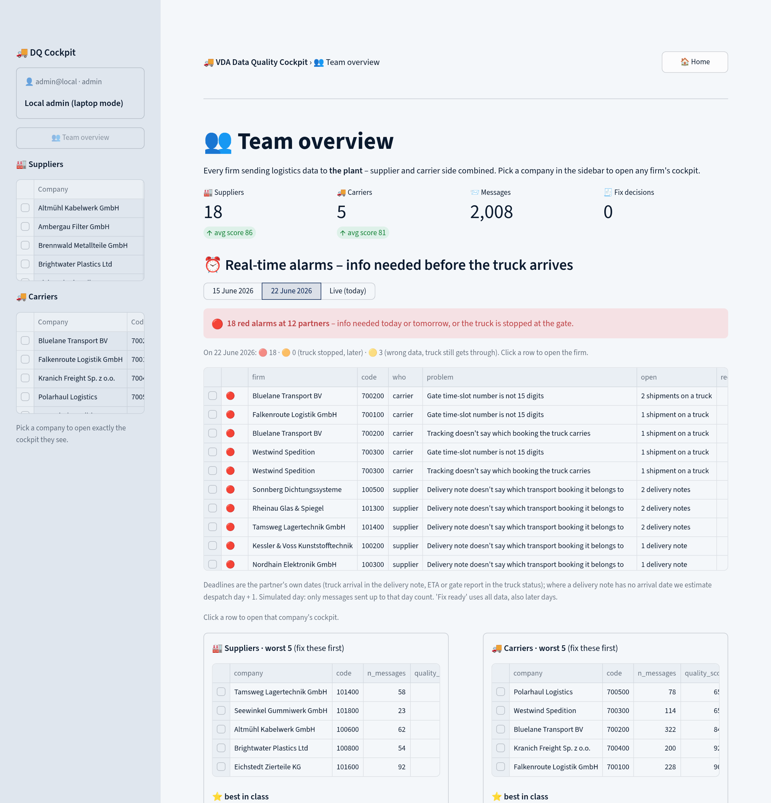
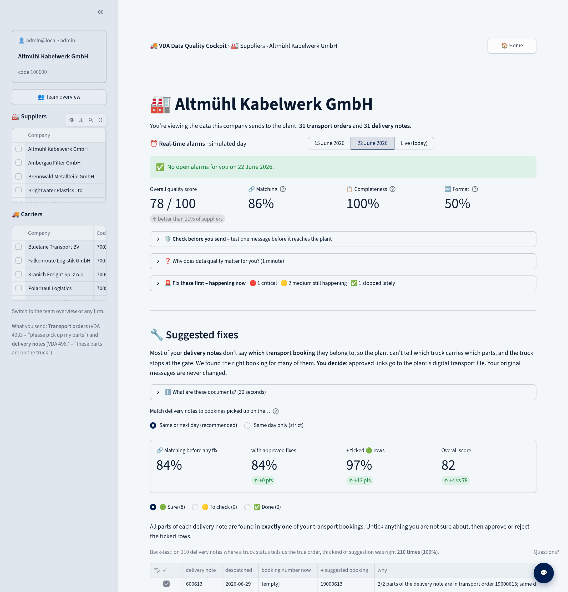
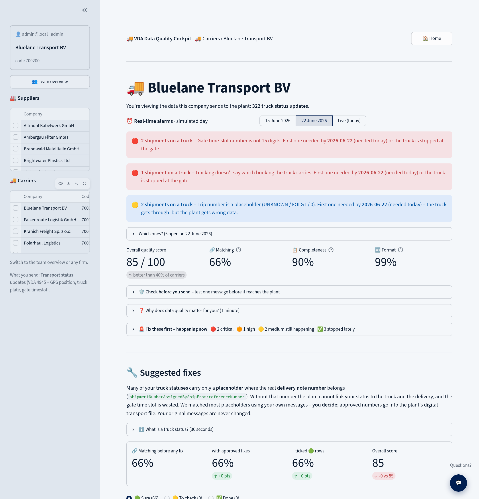

# VDA Data Quality Cockpit

**Warns a car plant's suppliers and carriers *before* their truck is stopped at the gate, finds the missing
reference numbers in their own data, and lets them fix the problem with one click.**

Built in 48 hours at the *AI × Data Supply Chain* hackathon (42 Berlin, with Volkswagen Group Logistics and
Databricks, November 2026), Challenge 02 "Data Quality Cockpit". It was the only team demo running live
end to end.



> All screenshots use **generated, fictional data** (`scripts/make_demo_data.py`). The hackathon dataset is
> confidential and is not part of this repository.

---

## The problem in 30 seconds

Every truck that delivers parts to a car plant comes with three electronic messages (German automotive
standard **VDA**):

| Message | Everyday equivalent | Sent by |
|---|---|---|
| **VDA 4933** transport order | booking the courier pick-up | supplier → carrier |
| **VDA 4987** delivery note (despatch advice) | the packing list | supplier → plant |
| **VDA 4945** transport status | parcel tracking (GPS, plate, gate timeslot) | carrier → plant |

The plant can only let a truck drive straight to unloading if the three messages **reference each other**.
In the real data, one reference number was missing from the large majority of delivery notes, so most
trucks couldn't be matched and had to be checked by hand at the gate. The suppliers didn't know, because
nobody showed them.

## What the cockpit does

| | |
|---|---|
| ⏰ **Warns in time** | Real-time alarms: "🔴 this truck will be stopped at the gate, the information is needed today". The alarm board covers all partners, and the same alarm appears on each partner's own page. |
| 📋 **Explains** | A quality score (matching / completeness / format) per company, with every problem in plain language: which field, who has to fix it and how. |
| 🔧 **Fixes** | A "detective" finds the missing booking number for each delivery note in the supplier's own data (same supplier, same day, same parts and amounts). Green = sure, yellow = check. One click approves them. Original messages are never changed, and every decision is logged and can be undone. |
| 🛡 **Prevents** | "Check before you send": paste a message and see instantly what the plant would find in it. |
| 💬 **Answers** | An LLM assistant (tool-calling, grounded in the company's own findings) answers "what should I fix first?" and can propose fixes. |

| Supplier view: score and suggested fixes | Carrier view: alarms first |
|---|---|
|  |  |

**Can the suggestions be trusted?** The detective was back-tested on delivery notes where the truck tracking
independently shows the true booking. On the hackathon data, the "sure" suggestions were right every time.

## Architecture

```
 VDA JSON messages ─► rule engine ─────────────► tables ───────────────► Cockpit (Streamlit)
  (zip files)          vda_dq/core.py              findings, scores,        alarms · score · fixes
                       29 VDA checks,              fix suggestions,         check-before-send
                       scoring, detective,         alarms, warnings         LLM assistant (tool calling)
                       alarms                      (Delta on Databricks,
                                                   DuckDB in laptop mode)
```

- **One engine, two runtimes.** `vda_dq/core.py` is pure Python (standard library only). The same code runs
  as a Databricks job (the notebook is *generated* from it) and on a laptop.
- **Laptop mode.** `local/` holds a tiny stand-in for the Databricks SQL connector backed by DuckDB, so the
  full app runs offline with no cloud account. That's what saved the live demo when the hackathon workspace
  hit its daily compute limit.
- **Audit-safe fixes.** Approvals go into append-only log tables (`sql/setup.sql`) and never into the
  original messages.
- **Tests.** 47 unit tests on synthetic messages, plus a headless smoke test that renders every page.

## Run it locally (about 1 minute)

```bash
pip install streamlit pandas duckdb pyarrow
COCKPIT_LOCAL_EMAIL=admin@local scripts/cockpit_local.sh
# → generates the demo data, runs the engine, opens http://localhost:8501 as admin
```

Other commands:

```bash
python3 -m unittest discover -s tests -v     # 47 rule tests
python3 scripts/smoke_cockpit.py              # render every page headless
python3 scripts/run_local.py demo_data out    # engine only → CSVs in out/
```

The LLM assistant needs a Databricks model-serving endpoint and is switched off in laptop mode.

<details>
<summary>Deploying to Databricks</summary>

```bash
cp deploy.env.example deploy.env              # fill in your warehouse / Genie space / folder
databricks auth login --host https://<your-workspace>.cloud.databricks.com
scripts/deploy.sh pipeline   # tables (Unity Catalog, Delta, Jobs)
scripts/deploy.sh genie      # AI/BI Genie space
scripts/deploy.sh app        # Databricks App
```
</details>

## Repository layout

```
vda_dq/core.py             parsing, 29 quality rules, scoring, detective, alarms (single source of truth)
apps/cockpit/              Streamlit app: pages, fixes, alarms, warnings, check-box, LLM agent
local/                     DuckDB stand-in for the Databricks SQL connector (laptop mode)
scripts/make_demo_data.py  fictional demo data generator
scripts/build_notebook.py  generates the Databricks notebook from core.py
scripts/deploy.sh          Databricks deploy (pipeline / genie / app)
tests/                     unit tests on synthetic messages
docs/CASE_STUDY.md         the story: challenge, approach, decisions, lessons
```

## Built with

Python · Streamlit · DuckDB · pandas · Databricks (Unity Catalog, Delta, Jobs, SQL Warehouse, AI/BI Genie,
Apps, Model Serving) · Claude Code as a pair programmer

## Team

[Carlos Denegri](https://github.com/cadenegr): rule engine, detective, alarms, assistant, data pipeline.
Cockpit UI built together with a teammate.

*Not affiliated with or endorsed by Volkswagen Group. Company names in the demo are fictional.*
